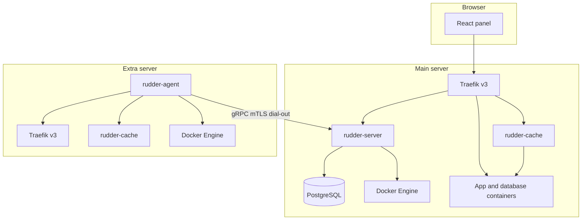

# Architecture

Rudder is a single-tenant control plane plus a per-server agent. Business logic talks to a `NodeDriver` so the panel server and remote agents expose the same operations.



## Layering

```text
domain            crates/core
  <- application  crates/server services and jobs
      <- infrastructure
          LocalDriver, RemoteDriver, sqlx repositories, S3, Traefik files
              <- interface
                  Axum routes, embedded SPA, agent gRPC session, CLI
```

Inner layers do not import outer layers. Unknown input is parsed at the HTTP, webhook, and gRPC boundaries before it becomes a domain value.

## Process model

- `rudder-server` owns users, desired state, the scheduler, and the panel database.
- `rudder-agent` dials out, so extra servers can sit behind NAT. After enrollment the session is mutually authenticated with an internal CA.
- `rudder-cache` is a separate process on each server. Traefik sends only opted-in domains through it.
- Compose stacks shell out to `docker compose`. Every other container call goes through the Docker API.

## Data

PostgreSQL is the system of record. Service-kind settings live in `services.spec` as JSON that matches serde types in `rudder-core`. Secrets are AES-256-GCM ciphertext. Logs and metrics are range-partitioned by day so retention drops old partitions instead of scanning a single heap.
